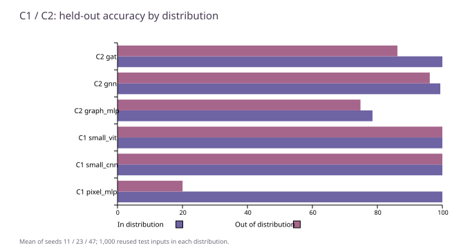

# C：位置变化与节点重编号——视觉网络和图网络在学什么

[返回显微镜总报告](README.zh-CN.md) · [D：深度与数值积分](D-depth-and-ode.zh-CN.md) · [E：生成模型](E-generative.zh-CN.md)

这篇补齐 **2026-10-26 BCD 补跑**中的 C1、C2 阅读记录。它不属于后来只做 A/B1/B2 的 v1.1；不能把两版测试或完成数相加当独立研究。

## C1：图形搬到边上，还能认出来吗

输入是 32×32 单通道合成图，四类为竖条、横条、十字和方框边界，幅值在 0.5—1 之间，另加标准差 0.02 的高斯噪声。训练和验证的图形中心位于坐标 12—19；测试前 1,000 张仍在这个范围，后 1,000 张把横坐标移到 5 或 26，纵坐标取 5—26。这里的 OOD（分布外）具体指这个位置变化，不是陌生物体或真实照片。

冻结数据有 8,192 训练行、1,000 验证行、2,000 测试行。三个模型共用这份输入；种子 11、23、47 改变训练随机性，不另抽三套测试。9 组输出共 18,000 行，是对同一 2,000 张图的重复测量，不能写成 18,000 张独立新图。

- **像素 MLP**：先把像素铺平为 1,024 个数，再经过宽 208 的两层隐藏网络。它没有显式的平移共享结构。
- **小 CNN**：三层 3×3 卷积、宽 112，最后全局平均池化。相同局部滤波器会用于不同位置。
- **小 ViT**：4×4 patch 产生 64 个 token，宽 96，两个 Transformer 层、四头注意力和可学习位置嵌入，最后平均池化。这是具体的小型实现，不代表所有 ViT。

三者用交叉熵（正确类别的预测概率越小，惩罚越大）、AdamW、学习率 0.0003、batch/microbatch 均为 64、FP32、梯度范数裁剪到 1。训练有放回抽样；选模用验证集前 256 行，不是完整 1,000 行。各组实际更新数不同，是原时间预算校准冻结后的配置，不能说同训练步数或同 FLOPs。

| 模型 | 参数量 | 实际更新/种子 | 全测试均值 ± 种子间样本标准差 | 分布内均值 | 分布外均值 |
| --- | ---: | ---: | ---: | ---: | ---: |
| pixel_mlp | 257,508 | 2048/2048/2048 | 60.0167% ± 0.9251 个百分点 | 100.0000% | 20.0333% |
| small_cnn | 227,588 | 1843/1843/1843 | 100.0000% ± 0.0000 个百分点 | 100.0000% | 100.0000% |
| small_vit | 231,844 | 1990/1990/1990 | 100.0000% ± 0.0000 个百分点 | 100.0000% | 100.0000% |

像素 MLP 在中心区域达到 100%，搬到边上降到约 20%；CNN 与小 ViT 在这套测试上都达到 100%。这支持“这个具体模型在这个位置变化任务上更稳健”，不证明普遍的视觉理解，也不能用满分消除四种简单图形、有限坐标和固定噪声分布带来的局限。ViT 也带位置嵌入，因此结果不等于证明它天然平移不变。

CNN 还有一份内部特征检查：验证集前 8 张图水平循环平移 2 像素，只比较内部裁剪区域。三种子相对 L2 误差都记录为 0。这是局部区域、固定平移的等变性诊断，不是任意边界、任意变换的证明；没有给 MLP/ViT 做相同诊断来组成完整机制排名。

## C2：换节点编号以后，答案应不应该变

任务输入是无向图的邻接矩阵和起点/终点/有效节点标记，输出两点是否连通。图统一补齐到 32 个节点；训练/验证有 8—12 个有效节点，测试前 1,000 个仍为 8—12，后 1,000 个为 16—32。边概率在 0.07—0.3 间随机取值，生成器通过拒绝采样交替构造不连通/连通目标。标签均衡不等于所有图统计捷径已经排除。

冻结输入共 8,000 训练行、1,000 验证行、2,000 测试行。三架构各三种子，9 组同样产生 18,000 行重复测量。损失、优化器、batch 和验证前 256 行选模规则与 C1 相同。

- **Graph MLP**：把邻接矩阵和节点特征直接铺平，宽 192，依赖固定编号表示。
- **GNN**：宽 144，六轮邻居均值消息传递，再对有效节点平均池化。
- **图注意力参考实现**：宽 112，同样六轮更新；只在邻边和自身上计算注意力。它不是对所有 GAT 变体的完整比较。

| 模型 | 参数量 | 实际更新/种子 | 全测试均值 ± 种子间样本标准差 | 分布内均值 | 分布外均值 |
| --- | ---: | ---: | ---: | ---: | ---: |
| gat | 227,810 | 1180/1180/1180 | 93.0833% ± 1.4869 个百分点 | 100.0000% | 86.1667% |
| gnn | 250,562 | 2048/2048/2048 | 97.7500% ± 1.0828 个百分点 | 99.3667% | 96.1333% |
| graph_mlp | 252,674 | 2048/2048/2048 | 76.6500% ± 0.7399 个百分点 | 78.5000% | 74.8000% |

GNN 在本次大图分桶上优于这个铺平 MLP；图注意力在该预算下低于 GNN。不能据此得出“注意力不如消息传递”的普遍结论：层数相同不等于训练更新、参数、计算和充分收敛完全相同。小图和大图结果要分别看，不能只报混合总分。

### 节点重编号控制

对测试前 256 个图同步打乱邻接行列与节点标记，标签保持不变。这 256 个样本全在原测试的小图部分，**没有覆盖后面的 1,000 个大图**。

| 模型 | 重编号后正确率均值 | 与原预测一致率均值 |
| --- | ---: | ---: |
| graph_mlp | 52.9948% | 50.2604% |
| gnn | 99.2188% | 100.0000% |
| gat | 100.0000% | 100.0000% |

一致率说的是“换编号后预测是否相同”，不是“预测是否正确”。GNN/图注意力的一致性支持这段实现的编号对称性；Graph MLP 的约 50% 一致率暴露了表示依赖。不能拿小图的这项控制证明大图或任意图分布的泛化。

## 核验层级与缺口

本次只在 CPU 读保存文件，重新计算 C1/C2 的完整标签正确率、分布内/外分桶，以及 9 组重编号控制；与现有结果一致。没有执行模型前向、训练或 GPU，也没有从仅有 argmax 的分类预测重建交叉熵。未核实完整的“仅节点数/边数/度数”捷径排除结果，因此保留这项方法学缺口；冻结数据的语义独立性也未由行数或随机种子自动保证。

逐组数值见 [cde-runs.csv](cde-runs.csv)，配置、分母、控制及来源 SHA256 见 [cde-summary.json](cde-summary.json)。原输入、逐条预测、源码和权重不随这篇公开摘要发布；本仓库不能一键复跑这组模型。来源导航见 [sources.md](sources.md)。
