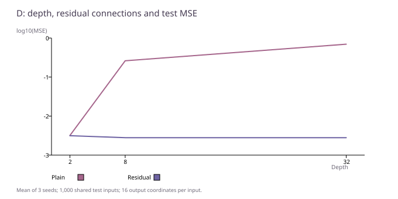

# D：加深网络、加入残差，与更细的数值步长是三件事

[返回显微镜总报告](README.zh-CN.md) · [C：视觉与图](C-visual-and-graph.zh-CN.md) · [E：生成模型](E-generative.zh-CN.md)

本页包括两个已有记录：2026-10-26 BCD 的神经网络回归训练，以及 v1 已保存的 Euler/RK4 数值参考。后者不是训练实验，不与前者共用准确率，也不因本次写报告重新积分。

## 受控回归任务

输入 x 是 16 维标准高斯向量，目标为固定合成映射 `y = W x + 0.1 sin(A x)`。W、A 是固定随机矩阵，元素标准差分别为 0.2、0.3；每个样本目标相同规则生成。训练 8,192 行、验证 1,000 行、测试 1,000 行，每个输出有 16 个坐标。

网络先将 16 维映射到宽 64，经过 2、8 或 32 个隐藏块，再输出 16 维。普通块为 `GELU(Linear(h))`；残差块为 `h + GELU(Linear(h))`，给原状态保留一条直接通路。同深度普通/残差参数相等，不同深度参数数目不同。

六配置各三种子 11/23/47，共 18 组。每组 AdamW、学习率 0.0003、batch/microbatch 64、FP32、梯度裁剪 1，实际都是 2,048 更新，即 131,072 次有放回样本呈现；这不是 131,072 个独立训练样本。每次选模仍只用验证前 256 行。测试使用按验证选择的检查点，不一定是最后一步。

MSE（均方误差）先平均一个样本 16 个坐标的平方差，再平均 1,000 个测试样本。它不是百分制准确率。18,000 行预测对应反复使用同一 1,000 个输入，不能当 18,000 个独立测试案例。

| 模型 | 参数量 | 测试 MSE 三种子均值 ± 样本标准差 |
| --- | ---: | ---: |
| plain2 | 10,448 | 0.003184 ± 0.000156 |
| residual2 | 10,448 | 0.003142 ± 0.000093 |
| plain8 | 35,408 | 0.261464 ± 0.002735 |
| residual8 | 35,408 | 0.002796 ± 0.000216 |
| plain32 | 135,248 | 0.695726 ± 0.000025 |
| residual32 | 135,248 | 0.002795 ± 0.000199 |

在这套固定任务和预算下，普通网络从 2 层到 32 层明显退化；残差 8/32 层仍保持较低误差。深度 2 时两者很接近，不能说任何时候加残差都会显著获益。这是优化和实现的受控观察，不证明“深度等于 ODE”，也不是等参数的深浅架构排名。

每组另存有一次选中检查点、验证前 16 行的梯度快照。例如 seed 11 的普通 32 层第一层激活梯度范数约 9.10e-18，末层约 5.57e-2；残差 32 层相应约 1.91e-2 和 4.87e-3。它与普通深层网络的优化困难相符，但只是单次小批次观察，不能替代整段训练曲线、干预或因果证明。更多种子快照的摘要在 JSON 中保留。

## Euler / RK4：已知向量场上的数值参考

已保存参考使用 `dx/dt = -0.7 x + 0.2 sin(x+t)`，初值 `[0.3, -0.7]`，从 t=0 积分到 1。对照是 8,192 步 RK4 的数值结果，**不是解析真解**。这里没有学习向量场、没有网络训练，原实现是 CPU 数值计算。

Euler 每步调用向量场一次；经典 RK4 每步调用四次。因此同样 K 不等于同计算量，应同时看 NFE（向量场求值次数）。

| 方法 | K 步数 | NFE | 相对数值参考的终点 L2 误差 |
| --- | ---: | ---: | ---: |
| Euler | 4 | 4 | 0.016589867 |
| RK4 | 4 | 16 | 1.1310956e-06 |
| Euler | 16 | 16 | 0.003790466 |
| RK4 | 16 | 64 | 4.362196e-09 |
| Euler | 64 | 64 | 0.00092728735 |
| RK4 | 64 | 256 | 1.7011926e-11 |
| Euler | 256 | 256 | 0.00023057965 |
| RK4 | 256 | 1024 | 7.301534e-14 |

例如 NFE=16 时，Euler K=16 的误差约 0.00379，RK4 K=4 约 1.13e-6；这是**同一光滑已知向量场**上的局部比较。它不能推出神经 ODE 比离散网络更好，也没有验证刚性问题、适应步长或训练后的向量场。

## 本次做了什么、没有做什么

本次从保存的 18 组预测离线复算 MSE，与结果文件一致；读取已有梯度快照和 ODE 表，没有加载权重、执行网络、重新训练或重新积分。源任务未提供完整的统计显著性/等计算架构胜负结论，本页也不补造。未发布原源码、逐条输入输出或权重，不能凭这几张表宣称独立外部复现。

[逐组统计 CSV](cde-runs.csv) · [分母、配置和来源哈希](cde-summary.json) · [来源导航](sources.md)
