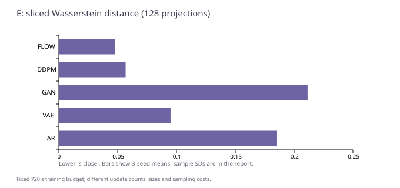

# E：五种生成目标，在已知二维分布上怎样比较

[返回显微镜总报告](README.zh-CN.md) · [C：视觉与图](C-visual-and-graph.zh-CN.md) · [D：深度与数值积分](D-depth-and-ode.zh-CN.md)

这是 2026-10-23 v1 的 E 阶段：五个小型从零训练参考模型、种子 11/23/47，共 15 组。不是 v1.1 新增实验，也不是大语言/图像基础模型训练。

## 数据与训练问题

真实分布已知：二维平面上八个等权高斯簇，中心均匀分布在半径 2 的圆上，簇内标准差 0.15。实际保存的冻结数组为训练 50,000 点、验证 10,000 点、测试 10,000 点。

模型训练都从同一训练数组取 batch 256；每种子预算 720 秒，AdamW 学习率 0.0003。它是相同壁钟预算，不是相同更新数、相同参数或同计算量，也不是各方法都已经充分收敛。原生成 worker 保存预算结束权重用于评价，未依据上述验证数组选择最优检查点；不能因为文件叫 `selected.pt` 就推断做过验证集选模。

| 参考模型 | 在学什么（通俗解释） | 参数量 | 三种子实际主优化更新数 | 默认采样 NFE |
| --- | --- | ---: | --- | ---: |
| ar | 先学 x，再学给定 x 的 y；两维均用 16 分量混合密度 | 46,752 | 43510 / 42161 / 43823 | 2 |
| vae | 编码均值/方差，重建点并约束潜变量接近标准高斯 | 76,422 | 43868 / 46173 / 45721 | 1 |
| gan | WGAN-GP：生成器与评论器交替，评论器带梯度惩罚 | 75,843 | 7191 / 7067 / 7246 | 1 |
| ddpm | 128 个离散噪声时刻，预测加入的噪声 | 38,210 | 165697 / 190858 / 151372 | 128 |
| flow | 沿噪声到数据的直线路径，预测速度 x−z | 38,210 | 172167 / 179440 / 154656 | 64 |

WGAN-GP 每个生成器更新对应 5 个评论器更新，表中是生成器步数，不把两者混算。GAN 参数量含生成器和评论器；采样时只用生成器。VAE 的重建项假设标准差 0.15，另加 KL 项；DDPM 学噪声 MSE；Flow 学速度 MSE；AR 优化密度 NLL。**这些 loss 不在同一尺度，不能按原 loss 数值排智力榜。**

每组保存 10,000 个生成点，与共同的 10,000 测试点比较。15 组总计 150,000 生成点是不同模型/种子的输出，不是 150,000 个独立真实测试样本。采样还复用了固定随机设置，进一步说明不能用点数制造额外独立种子。

## 结果怎样读

SWD-128 将两个点云投影到 128 个固定方向，逐方向排序后比较平均绝对距离，越小越接近；模式概率 L1 看最近八簇的占比偏差，越小越均衡；三倍标准差内比例看生成点有多少落在某个真簇中心半径 0.45 内，越大越集中于目标簇附近。这是二维径向距离阈值，不是“每个坐标三西格玛覆盖率”或固定置信概率。

| 模型 | SWD 均值 ± 种子样本标准差 ↓ | 模式概率 L1 均值 ↓ | 半径 0.45 内比例均值 ↑ |
| --- | ---: | ---: | ---: |
| ar | 0.185473 ± 0.009961 | 0.262267 | 61.2500% |
| vae | 0.094959 ± 0.018538 | 0.078867 | 75.3900% |
| gan | 0.211438 ± 0.018331 | 0.289200 | 50.5000% |
| ddpm | 0.056767 ± 0.019791 | 0.069933 | 94.5967% |
| flow | 0.047556 ± 0.010932 | 0.047400 | 92.7333% |

本次 Flow 的平均 SWD 最低，DDPM 的目标簇附近比例更高；两项分别描述整体分布距离和局部集中程度，不应合并成没有预设规则的“总分”。所有方法的最近模式覆盖数都是 8，但把离群点硬分配到最近中心也能覆盖八区，不能据此宣称质量都很好。v1 分类汇总中 E 的 `exact_accuracy=None` 表示指标不适用，不是生成失败。

默认 NFE 为 AR 2、VAE/GAN 1、DDPM 128、Flow 64；不同网络的单次调用成本不同，NFE 也不是完整吞吐或显存指标。Flow 默认用 Euler 型离散步，不能把 D 的已知向量场 RK4 参考当作它已经验证的高阶采样结果。旧 Flow 分 K（1/4/16/64）质量项没有全部保存所需样本，不在此用它下结论。

## 审计通过到了哪一层

原 v1 文件审计覆盖 A36/E15：5,689 个检查、已保存输出评分不一致为 0，状态明确为 `SAVED_OUTPUT_CHECKS_PASSED_WITH_EXPLICIT_UNVERIFIED_METRICS`，**不是全部指标独立通过**。

仍有 90 项不能从保存输出独立核验：A 的 NLL 36 项、AR 精确 NLL 3 项、VAE 负 ELBO 3 项、Flow 分 K 质量 48 项。这些指标不是都属于 E，也不能把“没有可复核保存样本”改写成“数值已证伪”。DDPM 的部分噪声 score 诊断有保存文件，但它也不自动证明其他生成目标全部通过。

本次仅读取已有配置/结果和原指标审计，核对 15 组已报告主指标与审计摘要一致；没有重新采样、模型前向、权重回放或 GPU 检查。D 的已保存数值积分也未重跑。公开的是脱敏统计和说明，不是 E 的完整原始采样包或训练源码；独立人员不能仅凭此仓库一键复现本组训练。

逐种子主指标及更新数见 [cde-summary.json](cde-summary.json)；[cde-runs.csv](cde-runs.csv)便于筛选。原文件位置采用无用户名的相对证据键和 SHA256，见 [来源导航](sources.md)。
